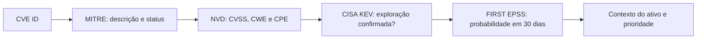

# CVE Field Guide — Consulta e Priorização para Profissionais de Cibersegurança

[](LICENSE)
[](docs/como-pesquisar.md)
[](https://www.cve.org/)
[](https://nvd.nist.gov/)
[](https://www.cisa.gov/known-exploited-vulnerabilities-catalog)

Guia de consulta rápida para identificar, enriquecer e priorizar vulnerabilidades com fontes primárias. **Revisão das fontes: 10 nov. 2026.** Confira a data e os dados diretamente nas fontes oficiais antes de tomar decisões operacionais.

## Comece em 30 segundos

1. Entenda os termos no [glossário](docs/glossario.md).
2. Use a tabela abaixo para ir direto à resposta.
3. Aprofunde-se na [tecnologia que você gerencia](docs/tecnologias/).

## Respostas rápidas

| Pergunta do profissional | Onde ir neste repositório | Fonte oficial |
|---|---|---|
| O que é um CVE? | [Glossário](docs/glossario.md) | [CVE Program](https://www.cve.org/) |
| Como pesquisar um CVE por produto? | [Guia de pesquisa](docs/como-pesquisar.md) | [NVD](https://nvd.nist.gov/) |
| Como priorizar o que corrigir primeiro? | [Priorização](docs/priorizacao.md) | [CISA KEV](https://www.cisa.gov/known-exploited-vulnerabilities-catalog) + [FIRST EPSS](https://www.first.org/epss/) |
| Quais CVEs afetam iPhone/iOS? | [iOS / iPhone](docs/tecnologias/ios-iphone.md) | [NVD](https://nvd.nist.gov/) / [Apple](https://support.apple.com/en-us/100100) |
| Quais CVEs afetam Windows? | [Windows](docs/tecnologias/windows.md) | [NVD](https://nvd.nist.gov/) / [Microsoft MSRC](https://msrc.microsoft.com/update-guide/vulnerability) |
| Como investigar Android ou navegadores? | [Android](docs/tecnologias/android.md), [Chrome](docs/tecnologias/chrome.md), [Safari e Firefox](docs/tecnologias/safari-e-firefox.md) | [Boletim Android](https://source.android.com/docs/security/bulletin), [Chrome Releases](https://chromereleases.googleblog.com/), [Mozilla](https://www.mozilla.org/security/known-vulnerabilities/) |
| O que observar em VPNs e appliances? | [Produtos corporativos](docs/tecnologias/produtos-corporativos.md) | [CISA KEV](https://www.cisa.gov/known-exploited-vulnerabilities-catalog) + avisos dos fornecedores |

## Fluxo de consulta



## Fontes oficiais em destaque

| CVE Program | NVD | CISA KEV | FIRST EPSS |
|---|---|---|---|
| [cve.org](https://www.cve.org/) | [nvd.nist.gov](https://nvd.nist.gov/) | [Catálogo KEV](https://www.cisa.gov/known-exploited-vulnerabilities-catalog) | [first.org/epss](https://www.first.org/epss/) |

Veja a [tabela mestre de fontes e APIs](data/links-oficiais.md) e o [guia de pesquisa passo a passo](docs/como-pesquisar.md).

## O que este repositório não é

Não substitui os registros, boletins e recomendações dos fornecedores ou das fontes oficiais. É um atalho de consulta e um guia de navegação; confirme versão afetada, mitigação, exploração e prazo nas fontes primárias.

## Exemplo de resposta da API NVD

Consulta direta: [`CVE-2021-44228`](https://services.nvd.nist.gov/rest/json/cves/2.0?cveId=CVE-2021-44228). Recorte ilustrativo dos campos retornados (valores completos e atuais na resposta da API):

```json
{
	"vulnerabilities": [
		{
			"cve": {
				"id": "CVE-2021-44228",
				"descriptions": [{ "lang": "en", "value": "..." }],
				"metrics": { "cvssMetricV31": [{ "cvssData": { "baseScore": 10.0 } }] },
				"weaknesses": [{ "description": [{ "value": "CWE-502" }] }]
			}
		}
	]
}
```

## Navegação

- [Glossário](docs/glossario.md)
- [Como pesquisar](docs/como-pesquisar.md)
- [Priorização CVSS × EPSS × KEV](docs/priorizacao.md)
- [Guias por tecnologia](docs/tecnologias/)
- [Links oficiais](data/links-oficiais.md)