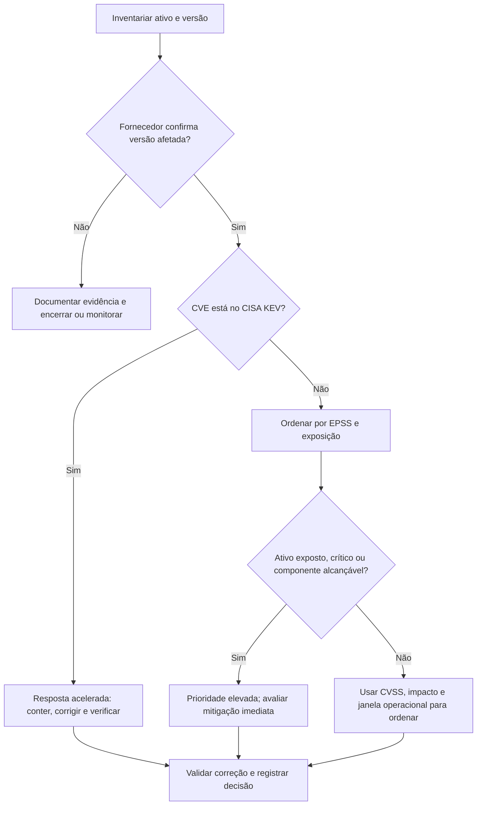

# Priorização: CVSS × EPSS × KEV

Nenhum indicador isolado determina a ordem correta para todos os ambientes. Combine evidência de exploração, probabilidade, severidade técnica e contexto do ativo; confirme aplicabilidade e correção nos avisos do fornecedor.

## O que cada sinal responde

| Sinal | O que responde | Escala | Atualização | Limitação |
|---|---|---|---|---|
| **CVSS** (Common Vulnerability Scoring System) | Qual é a severidade técnica segundo as características avaliadas? | 0,0–10,0 | Conforme novas avaliações/versões do registro | Não estima probabilidade de exploração nem impacto específico no negócio. |
| **EPSS** (Exploit Prediction Scoring System) | Qual a probabilidade estimada de exploração nos próximos 30 dias? | 0–1; também há percentil | Diária | Não mede impacto e pode mudar; é uma estimativa, não uma confirmação. |
| **KEV** (Known Exploited Vulnerabilities) | A CISA cataloga exploração conhecida desta vulnerabilidade? | Presente/ausente | Catálogo atualizado pela CISA | Reativo: ausência não prova ausência de exploração. Confirme que seu produto/versão está afetado. |

Fontes: [FIRST CVSS](https://www.first.org/cvss/), [FIRST EPSS](https://www.first.org/epss/) e [CISA KEV](https://www.cisa.gov/known-exploited-vulnerabilities-catalog). CVSS mede severidade; não trate CVSS, EPSS e percentil como escalas intercambiáveis.

## Fluxo de decisão

## Procedimento aplicável

1. **Aplicabilidade:** confira produto, versão, configuração e orientação do fornecedor. Uma correspondência de CPE é indício, não prova suficiente.
2. **KEV primeiro:** se o CVE está no catálogo e o ativo está afetado, inicie tratamento urgente, avaliando exposição, contenção e prazo regulatório/contratual.
3. **EPSS em seguida:** para os demais, ordene pela probabilidade e percentil atualizados, especialmente em ativos expostos ou críticos.
4. **CVSS como severidade:** use para comparar impacto técnico e desempatar, não como preditor de exploração.
5. **Contexto e execução:** alcance do componente vulnerável, internet, privilégio, controles, criticidade do negócio e janela de manutenção determinam a ação final.
6. **Reavalie:** salve data/hora e fontes consultadas; atualize KEV e EPSS e reavalie após mudança no ativo ou nos dados.

## Exemplo didático (dados fictícios)

Os três casos abaixo são cenários fictícios, sem CVE IDs reais. Números e inclusão em KEV são apenas para ilustrar o método; não representam dados publicados por NVD, FIRST ou CISA.

| Caso fictício | KEV | EPSS fictício | CVSS fictício | Contexto |
|---|---:|---:|---:|---|
| **Falha A** | Sim | 0,18 | 7,5 | Appliance de VPN exposto; versão afetada confirmada. |
| **Falha B** | Não | 0,82 | 8,8 | Serviço exposto; versão afetada confirmada. |
| **Falha C** | Não | 0,06 | 9,8 | Estação interna; componente raramente habilitado. |

**Ordem ilustrativa:** A primeiro, por estar no KEV e afetar um serviço exposto; B em seguida, pela EPSS fictícia alta e exposição; C depois, apesar do CVSS fictício mais alto, pois o cenário presume menor exposição e alcançabilidade. A ordem pode mudar se o contexto for diferente. O exemplo não prescreve prazos universais.

## Registro mínimo da decisão

Para tornar a priorização auditável, anote `CVE`, ativo/versão, evidência de aplicabilidade, presença no KEV, EPSS e data, CVSS e vetor/fonte, exposição, ação, responsável, prazo e evidência de validação da correção.

Veja o [guia de pesquisa](como-pesquisar.md) e a [tabela de fontes oficiais](../data/links-oficiais.md).
